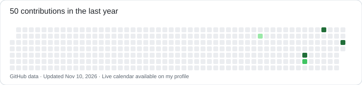

# Hi, I'm Dorian Emiliano 👋

**Software development student** building web apps, Android projects and embedded systems.

I'm developing **[MusicMad](https://github.com/Dorian1804/musicmad-pwa)**, a platform for musicians, and looking for opportunities to learn and collaborate.

### Languages

### Tools & technologies

### Currently learning

### Selected work

- **[MusicMad](https://github.com/Dorian1804/musicmad-pwa)** — my main project: music, community and PWA features.
- **[Web projects](https://github.com/Dorian1804/practicas-web)** — TaskFlow, React + Node.js and PHP applications.
- **[Android](https://github.com/Dorian1804/practicas-android)** · **[ESP32 & Arduino](https://github.com/Dorian1804/practicas-esp32-arduino)** · **[Java](https://github.com/Dorian1804/ejercicios-java)** · **[Python](https://github.com/Dorian1804/ejercicios-python)**

### Contributions

Actual GitHub activity. The image is a snapshot; the live contribution graph is below on my profile.
