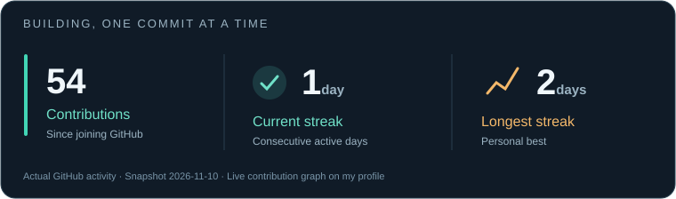

# Hey, I'm Dorian 👋

**Software development student** exploring web, mobile and embedded systems.
I'm building **[MusicMad](https://github.com/Dorian1804/musicmad-pwa)** and learning React and Node.js through hands-on projects.

### Languages

### Technologies & tools

### Learning now

**Explore my work:** [MusicMad](https://github.com/Dorian1804/musicmad-pwa) · [Web](https://github.com/Dorian1804/practicas-web) · [Android](https://github.com/Dorian1804/practicas-android) · [ESP32](https://github.com/Dorian1804/practicas-esp32-arduino) · [Java](https://github.com/Dorian1804/ejercicios-java) · [Python](https://github.com/Dorian1804/ejercicios-python)
